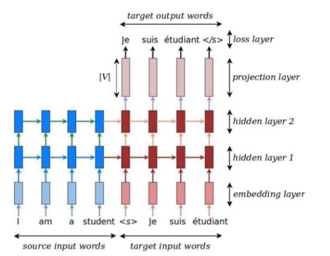
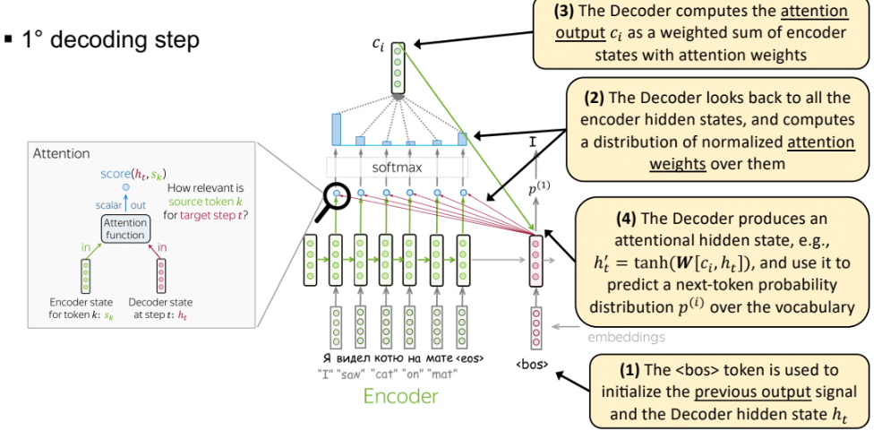

# Pre-Transformers

# Tokenization (slide 8a)
Tokenization is the way that NNs use to divide and see the world. Parole, sotto-parole (o più in generale, *`n`-grammi*).
I cancelletti, tipo in `surf` e `##ing`, rappresentano il risultato di una separazione; quell'`ing` è utile semanticamente,
perché indica l'azione che si sta compiendo.

Ci sono diversi algoritmi di tokenizazione ma hanno tutti una base comune. Di solito hanno delle regole a priori (non apprese),
per esempio sapere che le parole sono separate da *spazi* oppure la *punteggiatura*, l'utilizzo di *espressioni regolari*
(comode e leggere per l'analisi del testo, attualissime).

Per esempio il *byte-pair encoding* divide in caratteri ed unisce i più frequenti in modo iterativo, arrivando alle parole. 
Ogni parola riceve un identificatore, la corrispondenza al vocabolario della rete, che verrà usato durante l'inferenza. 

> GPT è generativo, BERT aveva solo l'encoder di un transformer quindi non generava ma faceva le cose solite delle NNs come classificazione.

Il problema principale si divide tra la scelta di **un vocabolario fisso**: la limitatezza del vocabolario porta difficoltà nella generazione di parole nuove. Ma dividendo i token in sotto-parole si potrà generare qualsiasi parola sconosciuta. 
- **Word-level**: numero di parole fisso, difficoltà nella generazione
- **Subword-level**: vocabolario molto più aperto e flessibile

> Molto spesso, gli errori degli LLM sbagliano a causa dei token.

*Se non capisco la frase non so nemmeno tokenizarla*, ci sta. Infatti ora le reti neurali imparano da sole. 
Un'altro problema sono gli **under-trained tokens**: quei token che si sono visti poco o niente durante il training; o 
magari anche token casuali che vengono da un dataset sporco (forum, chat, commenti).

# *Attention* prima dei transformers (slide 8a)

## Generative NLP
Si parla di ***generazione autoregressiva*** del testo, ma in realtà è un problema di classificazione. Qunado vogliamo il prossimo token, in realtà, il LM calcola la probabilità che un certo token vada bene col resto della frase.
Questa è effettivamente (*multi*)**classificazione**, in cui ogni token è una **classe**. 

E' autoregressivo perché il dato di output ritorna in input alla rete.

## Seq2Seq
Primi articoli del 2014 che propongono un architettura di modelli che prendono un input sequenze e danno sequenze, di lunghezza variabile. Molto utili per traduzione, captioning e riassunto.

E' composto da:
    - **Encoder**: cattura l'input in un vettore detto *context vector* (lunghezza fissa), cioè ciò che l'encoder ha capito dell'input
    - **Encoder**: prende il context vector ed esegue la computazione (in questo caso, la traduzione)

Di solito encoder e decoder sono implementati con le stesse reti neurali come LSTM o GRU (Gated Recurrent Units), due tipologie di reti ricorrenti. 
In generale c'è una chiara distinzione di ruoli: modellazione e generazione.

> Prima di LSTM e GRU c'erano altre RNNs con problemi di vanishing o exploding (underflow o overflow del numero macchina)

In passato la machine translation veniva eseguita spezzando la frase e traducendo, poi unendo assieme. Generando frasi molto robotiche e triviali. In questo modo si simula la **lettura, comprensione (con contesto) e traduzione**.

### Uso delle RNN nella traduzione
Questi modelli possono avere:
- Reti direzionali o bidirezionali in base al verso di lettura dell'input
- Multi-layer o single-layer: aggiungendo layer l'encoder può cambiare stato, influenzando il contesto in base ai token precedenti

Nel caso di bidirezionali ci sono due reti che leggono assieme. Infatti la rete che legge nel verso giusto comprende una parola
rispetto alle parole precedenti mentre la rete opposta si baserà sulle parole successive. Unendo i context vectori si hanno più informazioni.

In base alle dimensioni del context vector (256, 512, 1024 chars) cambia il livello di raffinazione della traduzione. Un vettore corto che traduce una frase lunga sarà più *grezza*, se invece è troppo grande rischia di apprendere rumore.

In una RNN l'attenzione è costruita tramite la ricorrenza su un livello. Un layer ricorrente ha sempre due output, uno che torna su se stesso ed uno che va in avanti. Nel collegamento di ritorno ci saranno pesi rispetto a quelli del livello stesso:
infatti questi pesi servono a comprendere la relazione della parola attuale con quella successiva (e non il suo significato).

In rosso l'encoder, in blu il decoder. Vediamo come ad ogni livello blu viene passato sia il contesto dalla parola precedente,
sia la parola corrente. Una volta arrivata a fine frase passiamo tutto al decoder.

### Loss function
I modelli Seq2Seq calcolano la probabilità di uscita del prossimo token rispetto al contesto. Questa probabilità la calcola
sia a partire dall'input dell'utente sia dall'output generato fino ad ora.

Sostanzialmente, per calcolare il $t$-esimo token devo trovare la probabilità rispetto all'input ed all'output generato:
$p = p(* | y_1, ..., y_n, x_1, ..., x_n)$

Il valore reale di un token che la rete dovrebbe dare in output è un vettore one-hot (solo una posizione ad 1) di tutto l'alfabeto dei token.

La loss function confronta il valore one-hot menzionato prima con il valore predetto, calcolando il logaritmo del valore predetto alla posizione del token atteso.

Il valore della loss viene usato per incrementare la probabilità che quel token venga fuori. Cambia il significato che la rete
ha appreso di quella parola, *spostandola* nel suo spazio vettoriale latente (tutto è un vettore); **cambiano gli embedding dei vettori**.
Questa cosa nella pratica viene fatta durante la back-propagation, spostando i pesi rispetto al gradiente.

Tramite l'embedding ed il training dei pesi, i modelli vanno ad organizzare semanticamente la loro visione del mondo. Per esempio, uno studio ha dimostrato come le frasi semanticamente simili sono codificate in posizioni vicine all'ultimo stato
dell'encoder.

## Seq2Seq con Attention (cross-attention)
Il problema è che frasi molto lunghe e svariati significati non possono essere codificati in un vettore di dimensione limitata.

Cerchiamo di dare pesi diversi all'input. Infatti, visto che siamo in una rete ricorrente con *hidden state* possiamo usare questi livelli per dare più attenzione.

1. Per ogni *hidden state* di ciascuna parola introduciamo dei pesi per denotare l'importanza della parola.
2. Quando produciamo il context vector finale andiamo a pesare il valore degli hidden state in una media pesata.
3. Si usa il context vector nel decoder

Ci sono 3 metodi per calcolare l'attention score ad un certo passo $k$:
- **prodotto riga per colonna** tra gli stati $k$ di encoder e decoder: qui non c'è nessun meccanismo aggiuntivo di attenzione, 
il risultato di questo calcolo dipende solo dai pesi imparati dalla rete.
- **multi-layer perceptron**: stati di encoder e decoder vengono concatenati, moltiplicati per dei pesi e passati in una tangente iperbolica.
- **Bilineare**: prodotto riga per colonna degli stati con una matrice di pesi (*per apprendere la relazione tra i due*).

Ora:
- nello step di encoding viene prodotto il context vector
- nel primo step di decoding viene usato il token `<bos>` per inizializzare il vettore di decoding
ad un generico passo di decoding:
1. si prende il hidden vector dello stato precedente del decoder
2. l'hidden vector viene passato nell'attention function assieme a tutti gli encoder state producendo un vettore di score
3. usando gli attention weights viene prodotto l'attention output `c`
4. l'attention output e l'hidden state vengono usati per la predizione del prossimo token. 

> **Problemi**:  L'attention cerca le relazioni tra una parola e tutte le altre, però più la sequenza si allunga **meno la rete riesce a ricordare
le relazioni tra due parole distanti**. 
**Non si può parallelizzare**, le parole devono entrare una per volta per avere il contesto giusto; non sfruttando bene le GPU.

Questa cosa è stata risolta con le **reti ricorrenti bidirezionali (B-RNN)**. La struttura rimane uguale, l'unico cambiamento
è nell'encoder: viene aggiunta una parte di rete che legge l'input da destra verso sinistra. Gli input delle due reti vengono poi concatenati.

