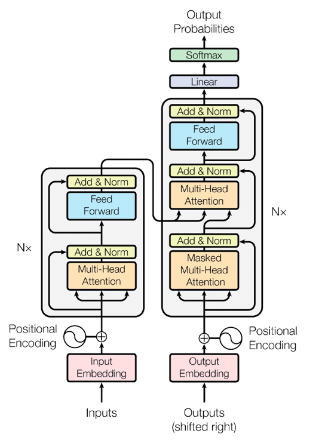
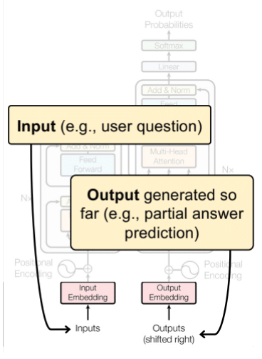
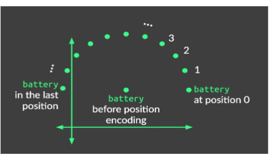

# Transformers (slide 8a)
I transformers possono affrontare qualsiasi problema di AI che prima veniva fatto con un modello diverso.
Principalmente nati per applicazioni text-to-text.

Formato da due moduli: encoder e decoder. Sono molto simili alla S2S studiata prima. 
Il ruolo in generale rimane quello: *comprendere* significato e concetti delle parole tramite **encoding** per poi
usarla nel **decoder** per risolvere il problema generativo.

> L'encoder da solo può fare classificazione, specialmente su dati non strutturati (testo, immagini)

## 1. Input and output embedding
Sia nell'input del decoder che in quello dell'encoder. E' possibile allenare l'*embedding layer*.

Tokenizzazione, poi ogni token è mappato in una matrice di dimensione variabile (es. 768 colonne, v. note precedenti).

## 2. Positional encoding
Viene passata una stringa intera quindi il modello **non ha idea dell'ordine delle parole**, questo perché tramite l'embedding
la frase viene trasformata in una matrice che non tiene il concetto di ordinamento.

> Per esempio, la stessa parola ripetuta in una frase viene rappresentata allo stesso modo anche se ha valore diverso.

Il **positional encoding** serve a questo, dopo aver fatto l'embedding di una parola al suo vettore viene aggiunto un embedding
posizionale (dipendente dalla posizione della parola nella frase) che sposterà quindi le coordinate di tutti gli embedding della frase.

 L'idea del positional encoding è di eseguire una rotazione relativa alla parola *naturale*, di una certa entità in base alla posizione della parola. Tutto ciò nello spazio di embedding.

Questo contribuisce ad aggiugnere un segnale posizionale/temporale da cui il modello può regolare l'attenzione.

**Proprietà**:
- C'è una **relazione lineare tra due posizioni codificate**, se c'è una relazione c'è un pattern e quindi è più facile da cogliere
- **Generalizzabile** su sequenze più **lunghe** di quelle del training
- Generato da un **processo deterministico**
- L'embedding è uguale per ogni posizione, **non dipende dalla parola**
- In certi transformers vengono aggiunti dei pesi alla funzione di positional embedding per *far imparare anche questo passaggio*

**Tipologie di p.e.:**
1. L'idea più semplice è aggiungere ad ogni componente del vettore di embedding l'indice della parola nella sequenza. Questo è un problema perché fa esplodere l'ordine di grandezza, portando problemi a livello di gradiente.
2. **Binary Positional Encoding**: si converte l'indice della parola in binario e si somma. Si sposta di poco rispetto a prima però la relazione tra due posizioni si muove a scatti (+1, +0... etc), in più non è derivabile questa funzione quindi è difficile da apprendere -> seno e coseno approssimano bene questa cosa!
3. **Sinusoidal Positional Encoding**: approssimando l'idea precedente con seno e coseno, il segnale posizionale è più facile da apprendere. Si usano funzioni seno e coseno alternate, una per le posizioni dispari e una per quelle pari del vettore di embedding.

$
PE_{(pos, 2i)} = \sin{(\frac{pos}{10000^{i/d}})}
$

Inoltre il parametro della funzione goniometrica non è solo la posizione, bensì dipende anche dalla posizione $i$ all'interno del vettore di embedding. In questo modo le posizioni dopo la 70esima (su $d = 512$) non contribuiscono alla codifica della posizione del token nella sequenza.
Quindi:
- le prime posizioni sono quelle che indicano la posizione della parola nella sequenza
- si rimane efficienti con le informazioni che si aggiungono senza aggiungere rumore superfluo
- In realtà il resto della sequenza non viene lasciata uguale, semplicemente viene sommata la stessa quantità a tutte (un valore molto vicino a $0$ o molto vicino a $1$).

> Questo però **non** ci permette di calcolare una **distanza relativa tra una parola e l'altra**.

## 3. Encoder 

Encoder e Decoder possono essere impilati in serie fino a 8-12 volte. In base a questo numero si hanno modelli *Small*, *Medium* o *Big* con cui si distinguono i modelli commerciali, qui l'architettura rimane la stessa e si impilano di più o di meno decoder.

Si distinguono architetture tradizionali e **mixture-of-experts** in cui **solo certi range di parametri sono attivati** in base all'input.

L'ultimo decoder della pila trasmette il suo output ai decoder, tutti quanti (1-n). In passato l'attenzione veniva fatta usando connessioni ricorrenti o CNN mentre ora l'unico meccanismo è l'*attenzione*.

Quando si procede lungo i layer del decoder, più si va avanti più le parole vengono *modificate* anche estraendone il **significato**. 

Nei transformer si hanno due tipi di attention:
- **self-attention**: ogni parola si confronta (*self*) con le altre parole per capirne il significato
- **cross-attention**: il decoder incrocia il proprio output (ottenuto fino ad ora) con l'output del decoder

La **self-attention**, nella **multi-head attention** nel decoder, confronta ciascuna parola con tutte le altre per andare a capire quale sia la parola che ha la **relazione più forte** con le altre, il *risultato del confronto viene aggiunto* alla parola presa in esame. 
Sostanzialmente si va a calcolare la combinazione lineare tra pesi e tutte le parole, per calcolare la parola nuova. I pesi con cui si combinano le parole sono imparati e vi viene fatta la **Softmax**. 

> I pesi con cui viene fatta la combinazione lineare sono **specifici per ciascun token** che si sta prendendo in esame.

In particolare nel transformer ci sono 3 matrici che vengono prodotte/usate da ciascun token:
- **Query**: tramite i pesi di query viene prodotto un vettore che permette agli altri token di potersi **confrontare** tramite l'attenzione 
- **Key**: prodotta tramite i pesi di key, questo vettore espone le ***caratteristiche della parola*** così che possa essere trovata.
- **Value**: prodotta tramite i pesi di value, rappresenta il significato semantico da combinare assieme ad altre parole.

Esattamente come nelle hashmaps, si possono usare i **Key vector per trovare le parole col significato più rilevante**. Una volta reperita si **usa il Value vector per reperire il valore utile**. I **Query vector sono usati per cercare tra i Key vector**. 

Durante l'attenzione questo viene fatto con una matrice, in cui in ogni riga vi è una parola:
Essendo una matrice, tramite il prodotti riga per colonna, vengono esplorate tutte le coppie di parole per fare l'attenzione.
 
1. La matrice $Q\times K^T$ (quando si interroga una Query) diventa una **matrice di covarianza**, in ogni cella $(i,j)$ vi è la quantità di correlazione che c'è tra la parola $i$ e la parola $j$.
2. La Softmax di questa matrice ci ritorna una distribuzione di probabilità, molto più gestibile numericamente.
3. La matrice ottenuta viene moltiplicata per la matrice Value ($V$) ottenendo la matrice degli embedding, dove ogni riga rappresenta l'embedding di una parola.

### Multi-head
>E' sufficiente una sola attention? 

La multi-head attention serve a questo: vengono eseguite diverse attention in parallelo (8, nel transformer originale) che catturano significati e relazioni diverse. Per passare il risultato al blocco superiore (*che possono essere altre attention in serie oppure un altro decoder*) bisogna fare **pooling**. 

Nel **pooling** tutte le testate vengono concatenate assieme e moltiplicate per un'altra matrice $W^O$, anch'essa imparata tramite pesi, per combinare correttamente i pesi.

In alternativa, per migliorare la performance si possono calcolare le matrici $Q, K, V$ **una volta sola** per poi **dividerle nelle $h$ testate** e passarle nell'attention. La dimensione è la medesima ma si riducono i calcoli. 
Il funzionamento di concatenazione è il medesimo.

> Multi-head attention non aumenta la dimensione del modello, solo la computazionalità

### Why three matrices? 
>Perché tre matrici e perché distinte?

Se usassimo una matrice andiamo a *mischiare* concetti diversi e funzioni diverse della parola. Il significato di una parola si mischia con la sua necessità di segnalare il significato semantico

Quattro matrici sarebbero addirittura troppe o ridondanti.

### LayerNorm: Add & Norm
La **Add** aggiunge l'input e l'output dell'attention. I suoi ruoli sono:
- Rendere il **gradiente stabile**: se l'attention non impara nulla allora non rischiamo il problema del **vanishing gradient**
- Aiuta il modello a **trattenere dettagli importanti dell'input**: evitando che l'attention sia biased

La **Norm** riporta i vettori entro un range, fin'ora infatti l'attention e la add non erano delimitate da niente. *Evita l'instabilità numerica*. 
- Fa in modo che abbia **media $0$ e deviazione standard $1$**.
- Riduce l'overfitting, evitando che la loss diverga troppo e che non si impari dalla distribuzione di pattern

Questo layer ha due **parametri** che possono essere **appresi**:
- fattore di **scala** dopo la normalizzazione (di nuovo nello *spazio originale*)
- fattore di **bias**

Alla fine:
1. Add di attention matrix ($Y$) e residual connection ($X$): $A = X + Y$
2. Normalizzazione: calcolata media e deviazione standard di $A$ e viene applicata la funzione di standardizzazione
$
Z = \frac{A - \mu}{\sqrt{\sigma^2 + \epsilon}}
$
3. Scaling e bias: $Z \cdot s + b$

## 4. Decoder
